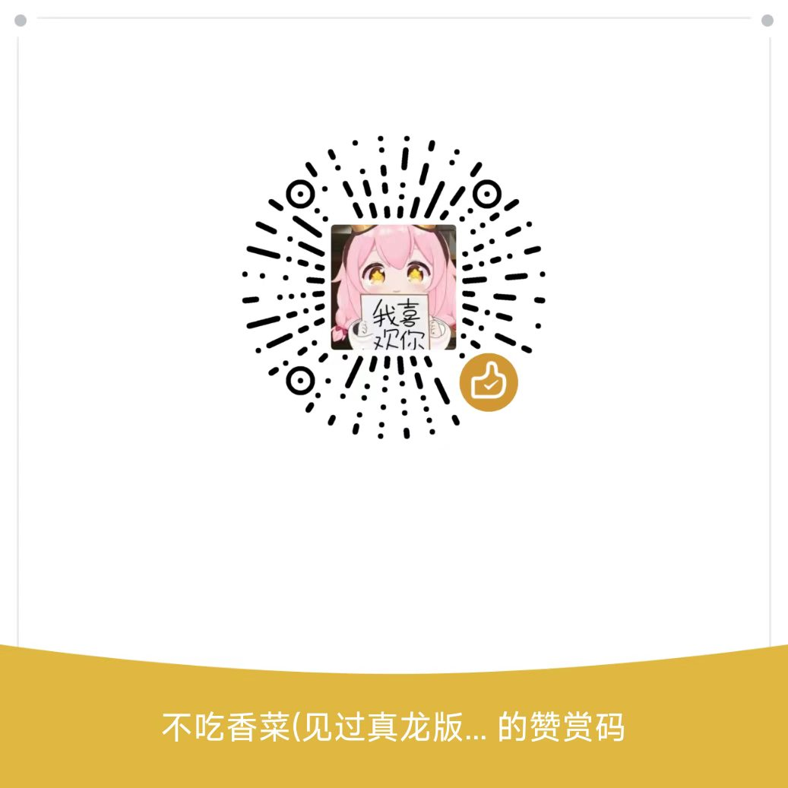

# CVE-2026-98260 — posix-cpu-timers UAF (Android LPE)

English | [简体中文](README.zh-CN.md)

## Vulnerability

| Item | Value |
|---|---|
| CVE | CVE-2026-98260 |
| Type | LPE, use-after-free (timerqueue rb-tree erase) |
| Target | Honor MagicPad3 Pro 13.3 YLP-W00 (Android 16) |
| Kernels | `6.12.38` (MagicOS 10.0.0), `6.12.58` (MagicOS 11.0.0.109 / 11.0.0.117 SP4) |
| SELinux | Enforcing |
| Mitigations | KASLR on; SMEP/SMAP/PAN on; KASAN compiled but off |
| Scope | bootloader locked; no partition writes |

## Root cause

A non-leader thread whose `execve()` fails keeps its queued posix-cpu timer
node. When the zombie is released, `release_task()` → `posix_cpu_timers_exit()`
→ `cleanup_timerqueue()` runs `rb_erase()` on a `k_itimer` that
`exit_itimers()` already freed. The stale node lives in a freed slab page.

## LPE chain (technical detail)

**Shared primitive.** The exec'd child's private `cred` (cred_jar, 0xb8) is
leaked from the `kmem_cache_alloc` trace (call-site low21 `0x19c474`); the
KASLR slide comes from the timer call site. The victim's `k_itimer` slab is
freed and reclaimed by AF_UNIX send fragments (order 0–3); the payload places
a fake rb node at `V+0x78`: `__rb_parent_color = A` (the node's own address),
`rb_right = 0`, `rb_left = target`. `RB_EMPTY_NODE()` is therefore true and
`rb_next()` returns NULL, so `cleanup_timerqueue()` pops exactly this node;
`__rb_erase_augmented()` takes the left-child case and writes
`__rb_parent_color` to `target`.

**A. Trigger (`src/poc.c`).** Same failed-exec setup without a payload: the
reap erases the stale node against freed memory and panics in
`cleanup_timerqueue()`.

**B. Fake cred (`src/exp.c`).** Two reaps point the helper's `cred` at a fake
cred built in the reclaimed page (`user_ns`/`group_info`/`ucounts` reuse the
real `init_*` symbols). It verifies the primitive (`getuid()==0 &&
geteuid()==0`) but cannot exec: `commit_creds()` has
`BUG_ON(cred != real_cred)` and the fake cred has `security = NULL`.

**C. Real-cred zero write (`src/uid0.c`).** Write `target = cred + 8`
(uid/gid) in place; the child calls `setuid(0)` (kuid == old uid, no
CAP_SETUID) and execs `/system/bin/sh` → uid-0 shell in `u:r:shell:s0`
(bounding set only, no `CAP_DAC_OVERRIDE`).

**D. KernelSU (`app/`).** Three more writes on the same primitive:
`selinux_state - 7` (permissive), `cred + 0x40` (bit 16 = CAP_SYS_MODULE),
`cred + 8` (loader uid/gid). The loader then `finit_module()`s
`kernelsu.ko` patched for the running release (vermagic rewrite, 226 symbols
relocated by the slide); the launcher stays uid 2000 and the module grants
root (`su -c id` → `u:r:ksu:s0`).

## Adapted versions

| Kernel release | Device / OS | Status |
|---|---|---|
| `6.12.38-android16-5-gfde7767f6ef6-abogki481467632-4k` | YLP-W00 / MagicOS 10.0.0 | verified |
| `6.12.58-android16-6-g3a7ac1674240-abogki541502914-4k` | YLP-W00 / MagicOS 11.0.0.109 | verified |
| `6.12.58-android16-6-g142ddad31e60-abogki576095858-4k` | YLP-W00 / MagicOS 11.0.0.117(SP4) | verified; event IDs probed at runtime |

Each profile carries its own call sites, `selinux_state` and a 226-symbol
`ko-syms` table; binaries and the APK select by exact `uname -r`.

`scripts/adapt.py` regenerates the profile and `ko-syms` table from a new
`vmlinux.elf` (optional `--baseline`, `--config`, `--ko`). The app loads
only the exact `ko-syms-<uname -r>.txt`; `ko_patch` validates the table
header and fails closed on release or count mismatch.

```sh
python3 scripts/adapt.py --release-dir <dir-with-vmlinux.elf> \
    [--baseline <previous-release-dir>] [--ko kernelsu.ko] [--out <dir>]
```

## Build and run

```sh
make            # build/poc   (trigger only)
make exp        # build/exp   (fake-cred proof)
make uid0       # build/uid0  (uid-0 shell)
make apk        # app/CVE98260Root.apk

adb shell mkdir -p /data/local/tmp/cve98260
adb push build/uid0 /data/local/tmp/cve98260/uid0
adb shell chmod 755 /data/local/tmp/cve98260/uid0
adb shell /data/local/tmp/cve98260/uid0 --check
adb shell /data/local/tmp/cve98260/uid0
```

App: install `app/CVE98260Root.apk`, start Shizuku as shell, then
`1. 授权 Shizuku` → `2. 部署资产` → `3. 开始提权`. Assets go to
`/data/local/tmp/cve98260`; `ksud`/`kernelsu.ko` are cached under
`cache/` keyed by manager version/APK stamp and `uname -r`. Live output
uses logcat tag `CVE98260`; a finished run writes `/sdcard/cve98260.log`.

## Repository

```text
src/poc.c              trigger only
src/exp.c              fake-cred chain
src/uid0.c             real-cred uid-0 shell
src/kernel_profile.h   per-release call sites, symbols, offsets
app/                   Shizuku + KernelSU app
docs/analysis.md       technical notes
docs/release-notes.md  release record
```

Release: [`v1.4.7-app`](https://github.com/woshigenm/CVE-2026-98260/releases/tag/v1.4.7-app).
License: MIT, see [`LICENSE`](LICENSE).

## Donate

If this work helped you, you can buy the author a drink:


